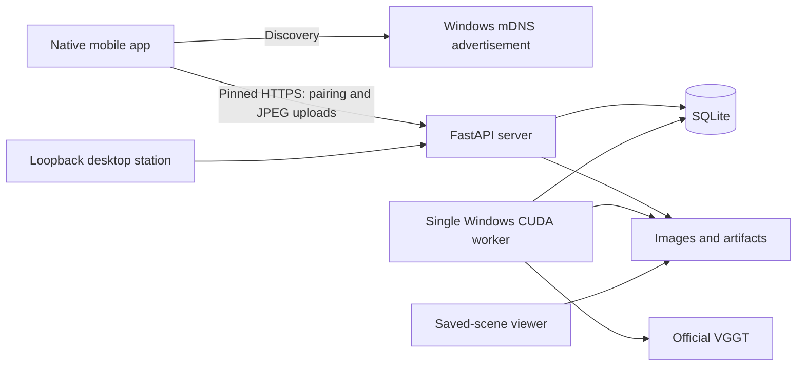

# IoTDesign design

## Architecture

The native Expo/React Native app owns camera capture and a durable upload queue. A Windows FastAPI process owns HTTPS, pairing, mDNS advertisement, SQLite, and image/artifact access. A separate Windows CUDA worker claims reconstruction jobs from the same database and writes artifacts to the same data directory.

The original plan proposed WSL2 Ubuntu for the worker. The current implementation uses Windows-native CUDA, including an `msvcrt` lock. This avoids introducing shared-filesystem and networking assumptions into the validated path. A WSL2 worker requires a deliberate portability and storage migration.

## Connection and trust

The server advertises `_iotdesign._tcp.local.` with identity, API-version, port, and certificate information. The app checks a saved address while discovering for eight seconds. A remembered stable server ID takes priority; a single new candidate enters pairing, and multiple candidates require selection. Manual address entry provides a fallback.

Health checks establish compatibility and compare the reported fingerprint with the TLS peer fingerprint. First-time manual pairing requires comparison with the desktop fingerprint. The QR route carries pairing information and pins the supplied fingerprint. An eight-digit expiring pairing code is exchanged for a credential. Subsequent requests authenticate with that credential and pin the saved certificate.

Server identity/address and credentials are persisted through SecureStore. Address changes can be recovered using the stable ID after authenticated reconnection. A changed certificate requires renewed trust. App foreground/network events trigger connection checks. Desktop pairing-code endpoints are restricted to loopback.

## Capture and upload

The app requests camera access and displays a rear-camera preview. It captures approximately once every two seconds, with a maximum of 30 images per scan. Current resizing preserves aspect ratio with a maximum 1280-pixel edge; it does not guarantee a 1280 x 720 JPEG. Actual dimensions, timestamp, scan ID, and frame ID accompany every upload.

Each image is saved locally before upload. Acknowledgment removes it from the pending queue and permits deletion of that local queued file. Interrupted uploads retain pending images. The server validates decoded JPEG data and dimensions, enforces the 10 MiB frame limit, and uses frame IDs for idempotency. Source images remain on the PC after reconstruction.

## Persistence and jobs

SQLite stores server metadata, paired clients, scans, frames, jobs, and worker heartbeat. Image and artifact bytes live in files rather than database blobs.

Scans begin as `capturing`, become `frozen` when reconstruction is queued, and become `completed` after successful export. Jobs move through `queued`, `running`, and `completed` or `failed`. A failed job may leave its scan frozen; job state is the authoritative failure indicator. Reconstruction freezes the input set so uploads cannot silently alter a queued job.

One worker holds the OS lock and claims one job at a time. On worker startup, interrupted running jobs are marked failed with preserved source images. The desktop retry action queues another attempt. A heartbeat distinguishes a healthy worker from a stale one. Benchmarks share the worker lock, so stop the worker before running a benchmark against its data directory.

## Reconstruction and point count

Official VGGT estimates camera poses and depth from evenly selected source images. Original JPEGs are preserved while model inputs are resized separately. The current worker default is a 336-pixel input width aligned to the model's patch size. Camera/depth inference uses CUDA mixed precision.

Export keeps finite, positive-depth points whose confidence is at or above the median. If more than 500,000 remain, deterministic sampling caps the exported cloud at 500,000 points. This is an application export limit, not a model guarantee or an accuracy score. A reconstruction memory failure retries once with eight images when the initial selection exceeds eight. Benchmark runs disable that retry to preserve the requested 8/12/20 comparison.

Artifacts include colored `cloud.ply`, estimated `cameras.json`, `preview.jpg`, `viewer.npz`, and a versioned `scene.json`. Metrics include duration, input count/resolution, peak allocated VRAM, sampled process RAM, and exported point count. The preview is a source-image preview. The representation remains unscaled; real distances require a known measurement.

## Viewing and user experience

With `worker --segment-objects`, official SAM 2.1 Hiera Small runs after VGGT releases its model. It segments the selected images independently, one image at a time, at a maximum 1024-pixel edge. A 16 x 16 prompt grid proposes regions; quality filtering and a 64-mask per-frame limit bound storage. Overlapping masks remain separate, stored as packed bits in `objects.npz`. `objects.json` records frame IDs, processed/source dimensions, boxes, scores, and per-frame IDs. Colored overlays are provided in `objects-preview.jpg` and `objects-previews.zip`. The scene manifest links these artifacts, which retain the API's ownership checks.

Segmentation is opt-in through the CLI and enabled by Windows launcher's GPU profiles. `--semantic-objects` runs YOLO OpenImages Nano before SAM 2, releasing detector memory before segmentation. YOLO proposes category names and internal prompt boxes; SAM 2 supplies masks. IDs remain frame-local; moving and reflective classifications remain unknown. Masks can contain parts, overlapping objects or background surfaces. Detection does not guarantee that every mirror is found.

VGGT exports per-point frame indices and normalized original-image coordinates through resize/crop/padding and export filtering. These associate masks with surviving geometry. The desktop review page displays masks/contours and explicit exclusion controls. Revisions reject stale edits. `viewer-base.npz` and `cloud-unfiltered.ply` preserve base geometry for restoration without reconstructing. Association supplies approximate unscaled centroids where sufficient points exist; Mirror and Window positions remain withheld. The viewer can color points by proposed object and reload reviewed geometry. Automatic motion/material inference and measured placement remain separate future stages.

The preview displays colored mask regions and their contours, without bounding boxes. Bounding extents remain metadata for downstream processing, not the displayed representation.

The desktop station presents pairing, worker availability, scans, and reconstruction status. The saved-scene Viser viewer supports navigation and camera visualization. A separate Three.js HTML showcase loads the saved Pexels benchmark cloud and provides movement/orbit and zoom controls. Its file server is separate from the authenticated phone API.

The mobile flow progresses through discovery/manual connection, pairing, connected home, and capture. Connection errors should explain the action needed: permission access, network reachability, API compatibility, or renewed authentication. Capture exposes pause/resume, manual capture, thumbnails, upload counts, and finish.

## Validation limits and future work

The semantic path now adds CPU Grounding DINO Tiny prompted with `mirror.` between YOLO and SAM 2. Grounded boxes use the same resized-image coordinates as SAM prompts; same-category duplicates are suppressed. CUDA custom kernels are disabled for this Windows path. Scores are category proposals, not reflective-material certainty. The [grounded-mirror report](docs/research/grounded-mirror-validation.md) records poor mask accuracy despite improved candidate recall. There is no VLM scene-description pass.

For semantic masks, mirrors/glass, moving objects, and measured IoT placement, consult the [three-agent research synthesis](docs/research/README.md). Semantic proposals, image masks, provenance and explicit review are implemented. Motion/material inference, persistent tracks and measured placement remain research stages.

The Windows launcher probes CUDA FP16 execution and free memory, selects a conservative profile, caches selected models and starts hidden services. Its separate launcher lock serializes starts while the worker keeps its GPU lock. Server identity prevents reuse of unrelated installations; PID creation time and command/data-directory checks constrain stop operations. Low stores the VGGT aggregator in FP16 while retaining FP32 geometry heads. The [quantization report](docs/research/windows-low-memory-quantization.md) records backend limitations and measured resource use.

The Android emulator has run the native app, paired manually through its host gateway, and uploaded 30 virtual-camera frames. This verifies a simulated capture/transport path; it does not establish real-phone mDNS reliability or room reconstruction quality.

The Pexels 8/12/20 benchmark completed, but its nearly fixed camera and moving people produced poor geometry. Real-room multi-view validation remains open. Generated OpenAPI-based mobile types, WSL2 worker support, iPhone validation, and VGGT-Gaussian evaluation remain future work. RF simulation, measured placement geometry, persistent AR, and human motion reconstruction require separate designs.
